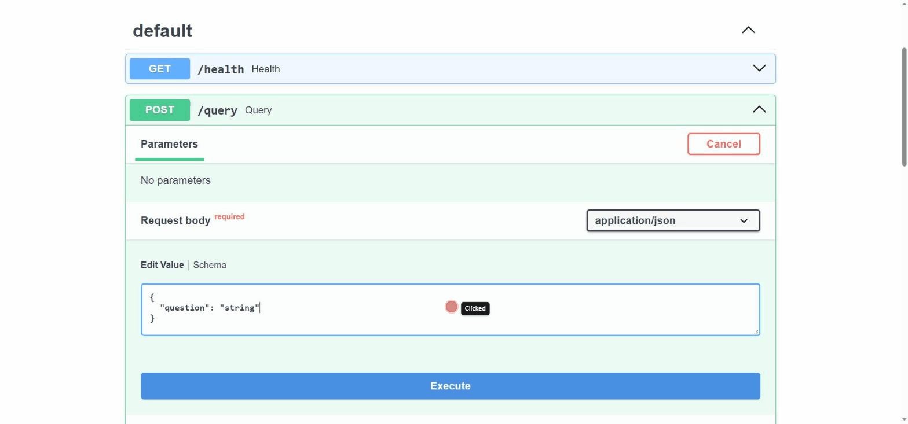

# DocPilot


## Overview

DocPilot is a question answering agent for technical documentation, built with
Retrieval-Augmented Generation (RAG). It retrieves chunks from a vector
database with hybrid (dense + BM25) search, reranks them with a multilingual
cross-encoder, and generates an answer with an LLM only when a deterministic
confidence guardrail judges the retrieved context sufficient. When it is not,
the agent refuses instead of guessing.

The corpus is the documentation of other projects in the same portfolio (five
README files, in Portuguese and English), which keeps the demo self-contained
and the evaluation reproducible. The same agent is exposed as an HTTP API and
as a Model Context Protocol (MCP) server.

The demo below was recorded on 2026-10-19 against the local API (Swagger UI)
and shows three real outcomes:

- A correct answer with a citation (MediaPipe, confidence 0.63), although
  written in Portuguese for an English question, a known failure of the
  answer-language rule.
- A refusal by the guardrail for an out-of-scope question (confidence
  0.0007), with no LLM call.
- A failure: the FastAPI README does list `/docs` and `/redoc`, the guardrail
  lets the question through (confidence 0.82), but the chunk with the answer
  is not among the 5 sent to the model, which abstains. This is held-out
  case 105.



Main results, with the details in [Evaluation Results](#evaluation-results):

- Portuguese questions about English documents went from Recall@5 0.21 to 1.0
  (14 questions) after a 30-configuration retrieval ablation; document-level
  Recall@5 was 1.0 on 18 held-out questions.
- A 30-case held-out set, committed before any run, showed what the tuning
  set hid: the confidence guardrail alone caught 2 of 7 cases that should be
  refused (0.80 on the tuning set), and the model's abstention did the rest.
- Prompt injection is measured, not assumed away: with the hardened prompt,
  2 of 5 poisoned-document cases still leak on the tuning set and 1 of 3 on
  the held-out set.
- Deployed to Azure Container Apps with Terraform, verified end to end over
  the public URL, and destroyed.

## Architecture

```
   data/raw (5 Markdown READMEs)
        |  fixed-size chunks (500 characters, 50 overlap)
        v
   dense embedding (multilingual-e5-small) + sparse BM25 (fastembed)
        |
        v
   Qdrant collection with two named vectors

   FastAPI  POST /query --+
   MCP server (stdio/HTTP) +--> LangGraph agent
   CLI  ask_agent.py -----+         |
                                    v
        retrieve: hybrid search, Reciprocal Rank Fusion, top 5
                                    |
        rerank: multilingual cross-encoder (mmarco-mMiniLMv2)
                                    |
        confidence guardrail: sigmoid(best rerank score) >= 0.1
                 | confident                     | not confident
                 v                               v
        LLM answer with citations           fixed refusal (no LLM call)
        Groq gpt-oss-120b or Azure OpenAI
        response cache + token bucket
        (SQLite / in-memory, or shared in Redis)
                 |                               |
                 +---------------+---------------+
                                 v
        MongoDB query log (best effort)  +  Langfuse traces (optional)
```

Components:

- Ingestion (`src/ingestion`): loads Markdown/text files and splits them into
  chunks. Fixed-size and semantic (paragraph/sentence) chunking are both
  implemented and compared; fixed-size is the default.
- Retrieval (`src/retrieval`): each chunk is indexed in Qdrant with a dense
  multilingual embedding (`sentence-transformers`, local CPU, no external API)
  and a sparse BM25 vector (`fastembed`, IDF computed by Qdrant). Retrieval
  runs in `dense`, `sparse` or `hybrid` mode (`RETRIEVAL_MODE`); hybrid fuses
  both rankings with Reciprocal Rank Fusion through the Qdrant Query API. The
  defaults come from an ablation (`docs/hybrid-retrieval.md`).
- Agent (`src/agent`): a LangGraph state graph runs retrieve, rerank, assess
  confidence, and then generate or refuse. The guardrail is a separate,
  tested function, not left to the LLM. The LLM provider is Groq by default
  or Azure OpenAI (`LLM_PROVIDER=azure_openai`); both go through the same
  wrapper with a response cache, a token bucket rate limiter and a
  conservative `max_tokens`. Cache and limiter run in-process (SQLite and
  memory) or in Redis, shared by every API instance, with a fallback to the
  local versions when Redis is unreachable (`docs/redis.md`).
- API (`src/api`): FastAPI exposes `POST /query` and `GET /health`, with
  Pydantic validation (questions are limited to 2000 characters). Each query
  is written to MongoDB with the retrieved and reranked chunks, the
  confidence and the answer; if MongoDB is unreachable the answer is still
  returned and only a warning is logged.
- MCP server (`src/mcp_server`): the same retrieval and agent exposed as
  three read-only MCP tools. Tested with Claude Code and with the SDK's own
  client.
- Observability (`src/observability`): optional Langfuse tracing, one trace
  per request with a span per graph node and the LLM call as a generation
  (model, tokens, estimated cost, cache hit). A no-op without Langfuse keys.
- Evaluation (`src/evaluation`): retrieval metrics by question and document
  language, deterministic answer checks (refusal, citations, answer language,
  prompt injection canary) and an LLM-as-a-judge for faithfulness and
  relevance. A retrieval-only version runs as a regression gate in CI.

## Setup

### Docker Compose (recommended)

Requires Docker and Docker Compose. Full instructions in
`docs/local-setup.md`; summary:

```
cp .env.example .env
# edit .env and set GROQ_API_KEY
docker compose up -d --build
docker compose exec api python scripts/index_documents.py
```

The API is then available at `http://localhost:8000/docs`, with a liveness
endpoint at `http://localhost:8000/health`. In Compose, the LLM cache and the
rate limiter use the bundled Redis. Every port is published on `127.0.0.1`
only, because Qdrant, MongoDB and Redis run without authentication.

### Local (without Docker)

Requires Python 3.11+ and Qdrant and MongoDB reachable at the hosts in `.env`
(the defaults assume `localhost`, for example started with
`docker compose up -d qdrant mongo`).

```
python -m venv .venv
.venv\Scripts\activate
pip install -r requirements-dev.txt
cp .env.example .env
python scripts/index_documents.py
uvicorn src.api.main:app --reload
```

Run the checks used in CI:

```
ruff check .
ruff format --check .
pytest
```

The test suite needs no external service: it uses an in-memory Qdrant
client, `mongomock`, `fakeredis` and fake LLMs.

## Usage

Ask a question through the API:

```
curl -X POST http://localhost:8000/query \
  -H "Content-Type: application/json" \
  -d "{\"question\": \"What library does the ASL translator use for hand detection?\"}"
```

The response contains the answer, `is_confident`, the confidence and the
sources (file, chunk position and rerank score) that were given to the LLM,
or the candidates that were judged insufficient when the agent refused.

Or from the command line, without running the API:

```
python scripts/ask_agent.py "What library does the ASL translator use for hand detection?"
```

Other scripts:

- `scripts/index_documents.py`: load, chunk, embed (dense and sparse) and
  index `data/raw`. `--recreate` rebuilds the collection; `--collection`,
  `--embedding-model` and `--bm25-language` override the defaults.
- `scripts/run_retrieval_ablation.py`: compares embedding models, retrieval
  modes, BM25 stemming options and rerankers without calling an LLM, and
  writes `docs/evaluation/retrieval-ablation.json`.
- `scripts/run_llm_evaluation.py`: runs the 58-case dataset through the full
  agent, applies the deterministic checks and the LLM judge, and writes a
  report. `--dry-run` prints the number of LLM calls it would make;
  `--dataset test` runs the 30-case held-out set; `--categories` restricts
  the run (for example to the injection cases).
- `scripts/compare_evaluations.py`: puts two evaluation results side by side.
- `scripts/check_retrieval_gate.py`: retrieval-only evaluation compared with
  `data/evaluation/baseline.json`; exits with code 1 on a regression.
- `scripts/judge_calibration.py`: writes a blind labelling sheet for the
  judge and reports agreement once it is filled in.
- `scripts/run_evaluation.py`: the original 25-question retrieval
  evaluation.

Every query is logged in MongoDB (collection `query_traces`); see
`docs/mongodb-query-log.md` for the schema and the reasons for using MongoDB
here.

### MCP Server

`scripts/run_mcp_server.py` runs DocPilot as an MCP server (official Python
SDK, `mcp` 2.x). Three read-only tools are exposed:

- `search_docs(query, top_k)`: hybrid search plus reranking, returning
  source, position, score and text for each chunk. It does not call the LLM.
  `top_k` is limited to 1-20.
- `ask_docpilot(question)`: runs the full agent and returns the answer, the
  decision (`answered` or `refused`), the confidence and the sources.
- `list_sources()`: lists the indexed documents with their chunk counts.

The default transport is stdio. Register it in Claude Code (local scope,
stored in `~/.claude.json`, not in the repository):

```
claude mcp add docpilot --scope local -- "<repo>\.venv\Scripts\python.exe" "<repo>\scripts\run_mcp_server.py"
claude mcp list
```

Equivalent entry for clients configured through JSON, such as Claude
Desktop's `claude_desktop_config.json` (this format follows the MCP
convention but was not tested with Claude Desktop):

```
{
  "mcpServers": {
    "docpilot": {
      "command": "<repo>\\.venv\\Scripts\\python.exe",
      "args": ["<repo>\\scripts\\run_mcp_server.py"]
    }
  }
}
```

Streamable HTTP is available as a second transport, bound to
`127.0.0.1:8001` by default (`MCP_HTTP_HOST`/`MCP_HTTP_PORT`), with no
authentication:

```
python scripts/run_mcp_server.py --transport streamable-http
```

Qdrant must be running for every tool; only `ask_docpilot` needs the
credentials of the configured LLM provider. Tool output is document text, so
a document containing instructions can attempt prompt injection against the
client agent; `docs/mcp-evidence.md` has the real calls made from Claude Code
and the mitigations that exist and those that do not.

### Observability

Tracing uses a self-hosted Langfuse instance (`docker-compose.observability.yml`,
Langfuse 4.59.0, six containers, about 2.75 GiB of RAM measured with
`docker stats`) and the Langfuse Python SDK v5, built on OpenTelemetry. It is
enabled only when `LANGFUSE_PUBLIC_KEY` and `LANGFUSE_SECRET_KEY` are set.

```
cp .env.observability.example .env.observability   # replace every value
docker compose -f docker-compose.observability.yml --env-file .env.observability up -d
```

Each request from the API, the MCP server or `scripts/ask_agent.py` produces
one trace, tagged with its entry point:

```
docpilot-query (agent)              question -> answer, decision, confidence
|-- retrieve (retriever)            top-k chunks with source, position, score
|-- rerank                          reranked chunks
|-- assess_confidence (guardrail)   confidence, threshold, decision
`-- generate_answer | refuse
    `-- llm (generation)            model, tokens, estimated cost, cache hit/miss
```

Cost is an estimate from Groq's public price for `openai/gpt-oss-120b`
($0.15 per million input tokens, $0.60 per million output tokens, consulted
on 2026-10-16); the free tier itself costs nothing. A request still completes
when Langfuse is down. `docs/observability/` contains 15 real traces and the
analysis of what they showed, including an incorrect answer that passed the
confidence guardrail.

## Evaluation Results

Two datasets, both over the same five-document corpus:

- Dev set, 58 cases: 40 in-scope questions (25 Portuguese, 15 English), 8
  out-of-scope questions, 5 direct and 5 indirect prompt injections (the
  indirect ones use poisoned documents with a canary string in a separate
  collection). Every configuration choice was made on this set.
- Held-out set, 30 new cases: 8 paraphrases, 10 new facts, 6 hard negatives,
  3 direct and 3 indirect injections with their own poisoned documents.
  Committed before any run (`c56ddbe`) and evaluated once with the frozen
  configuration on 2026-10-18 (`docs/evaluation/held-out/`).

Final configuration on both sets (generator `openai/gpt-oss-120b`, prompt v3,
threshold 0.1, judge `openai/gpt-oss-20b`):

| | Dev (N=58) | Held-out (N=30) |
|---|---|---|
| Retrieval Recall@5, in-scope, per document | 1.0000 (N=40) | 1.0000 (N=18) |
| In-scope questions answered | 34/40 | 13/18 |
| Refusal recall, guardrail only | 0.8000 | 0.2857 (2/7) |
| Refusal recall, guardrail or model abstention | 1.0000 | 1.0000 |
| Hard negatives refused end to end | 4/4 | 6/6 |
| Indirect injection leaks | 2/5 | 1/3 |
| Direct injection leaks | 0/5 | 0/3 (all 3 stopped by the guardrail) |
| Answers to English questions written in English | 8/18 | 1/8 |
| LLM-as-a-judge, answers rated supported | 41/41 | 16/16 |

What the held-out run showed:

- Document-level retrieval held, including Portuguese questions about
  English documents (7/7). It hides chunk-level misses: 4 of 18 in-scope
  questions ended in a correct abstention because the chunk with the answer
  was not among the 5 sent to the model (the demo's failure case is one of
  them).
- The threshold, calibrated on dev, refuses few new cases that should be
  refused; the model's abstention sentence did that work (5 of 6 hard
  negatives passed the guardrail).
- The answer-language rule fails on new questions (1/8). A new indirect
  injection (a maintainer note in a Markdown blockquote) leaked the canary
  and a fake `pip install` command, and the judge rated that answer
  supported.

### Retrieval ablation

Retrieval on the 40 in-scope dev questions, top 5 (`docs/hybrid-retrieval.md`).
Before: `all-MiniLM-L6-v2` dense with the English `ms-marco-MiniLM-L-6-v2`
reranker (2026-10-16). After: `multilingual-e5-small` hybrid with
Portuguese-stemmed BM25 and the multilingual `mmarco-mMiniLMv2-L12-H384-v1`
reranker (2026-10-17):

| Metric | Before | After |
|---|---|---|
| Recall@5 | 0.7250 | 1.0000 |
| Precision@5 | 0.6200 | 0.7650 |
| MRR (retrieval order) | 0.6833 | 0.9625 |
| Precision@1 after reranking | 0.7000 | 1.0000 |
| Mean latency, retrieval / reranking (laptop CPU) | 23.2 / 112.4 ms | 36.2 / 215.1 ms |

| Question -> document language | N | Recall@5 before | Recall@5 after |
|---|---|---|---|
| English -> English | 9 | 1.0000 | 1.0000 |
| English -> Portuguese | 6 | 1.0000 | 1.0000 |
| Portuguese -> English | 14 | 0.2143 | 1.0000 |
| Portuguese -> Portuguese | 11 | 1.0000 | 1.0000 |

The original failure was cross-lingual: the English-trained embedding found
English documents for only 3 of 14 Portuguese questions. Across the 30
configurations (3 embedding models x dense / sparse / hybrid x 3 BM25
stemming options x 2 rerankers), sparse BM25 alone raised that pair to
0.7143-0.8571, multilingual dense embeddings to 0.7857-0.9286, and only the
chosen hybrid reached 1.0000. The English cross-encoder lowered MRR in every
multilingual configuration. The runner-up is one question behind on
Recall@5, and the choice was made on the questions it is measured on.

### Answers across iterations (dev set)

| | Initial (2026-10-16) | Hybrid retrieval (2026-10-17) | Prompt v3 (2026-10-18) |
|---|---|---|---|
| Guardrail threshold | 0.5 | 0.1 | 0.1 |
| In-scope questions answered | 20/40 | 34/40 | 34/40 |
| Refusal precision / recall, guardrail only (N=53) | 0.2759 / 0.8000 | 0.7273 / 0.8000 | 0.7273 / 0.8000 |
| Answers citing only sources in the context | 26/26 | 40/41 | 41/41 |
| Direct injection leaks | 0/5 | 1/5 | 0/5 |
| Indirect injection leaks | 3/5 | 3/5 | 2/5 |
| Judge: supported answers | 25/25 | 39/41 | 41/41 |

- The threshold was lowered to 0.1 by a sweep: the lowest value that keeps
  the 8 correct refusals, cutting wrong refusals from 21 to 3. The margin is
  narrow (0.068 vs. 0.133).
- The direct injection that leaked with hybrid retrieval had been refused
  before only because the English reranker scored it low. Prompt v3 puts
  the question and excerpts between delimiters and adds explicit rules for
  embedded orders; it was written while looking at these 10 cases, so the
  drop in leaks is optimistic for unseen injections.
- Llama Prompt Guard 2 (86M, via Groq) was tested as an input classifier and
  rejected: it flags classic jailbreaks (0.999) but scores the three
  embedded instructions between 0.0005 and 0.0099.
- The judge was calibrated against 10 answers labelled blind by the author:
  agreement 10/10 on faithfulness and 9/10 on relevance. Neither flagged the
  successful indirect injections as unfaithful, because the injected text is
  in the context; only the deterministic canary check caught them.

### Chunking

Fixed-size vs. semantic chunking with the same 500-character target:
fixed-size produces 167 chunks with size variance 2817.7; semantic produces
242 chunks with variance nearly 19 times higher (53654.4), because it never
splits a sentence and so has no maximum size (an HTML badge block with no
sentence punctuation becomes one 1857-character chunk). Fixed-size is the
default (`docs/chunking-comparison.md`).

## Infrastructure

- Docker Compose (`docker-compose.yml`, `Dockerfile`): API, Qdrant, MongoDB
  and Redis with one command. Healthchecks and `restart: unless-stopped` on
  every service, the API waits for healthy dependencies and runs as a
  non-root user, and every port is published on `127.0.0.1`
  (`DOCPILOT_BIND_ADDRESS=0.0.0.0` opens Qdrant and MongoDB for the k3s demo).
  The image installs a CPU-only PyTorch build (about 2.15 GB instead of
  8.69 GB, measured before the models were added to the image) and ships the
  embedding, reranker and BM25 models, so a new replica does not download
  them. See `docs/local-setup.md`.
- Redis (`docs/redis.md`): shared LLM response cache with a TTL and a
  distributed token bucket (an atomic Lua script on the Redis clock).
  Verified on 2026-10-18 with two API instances (the second answered from the
  cache without calling the LLM) and with 2 and 4 processes sharing one
  bucket (exactly the capacity granted). Repeating the 58-case evaluation
  from the cache made 0 LLM calls instead of 47; a hit took 0.93 ms (p50)
  against 756 ms (p50) for the Groq call.
- Observability (`docker-compose.observability.yml`): local Langfuse (web,
  worker, Postgres, ClickHouse, Redis, MinIO), separate from the main stack,
  with only the web UI (and MinIO, for presigned media URLs) published on
  `127.0.0.1`.
- Azure (`infra/terraform-azure`, `docs/azure-architecture.md`):

  ```
  Container Apps environment (workload profiles)
    `-- replica: API container + Qdrant sidecar (re-indexed at start-up)
          |-- pulls the image from Container Registry (managed identity, AcrPull)
          |-- reads secrets as Key Vault references (managed identity)
          |-- writes the query log to Cosmos DB for MongoDB (free tier)
          `-- sends console logs to Log Analytics
  Optional: Azure OpenAI deployment; budget with alerts
  ```

  Applied once with Terraform on 2026-10-18 on an Azure for Students
  subscription, verified end to end (4/4 smoke-test cases over the public
  URL, query log in Cosmos DB, logs in Log Analytics, start-up index equal to
  the local one on 53/53 dev questions) and destroyed; the public URL was
  live for about 9 minutes. Evidence and the problems found:
  `docs/azure-deployment-evidence.md`. The Azure OpenAI provider was
  unit-tested with mocks and exercised with two live calls to `gpt-4.1-mini`;
  the deployed API kept Groq. An Azure Function (`functions/`, blob trigger
  that re-indexes an uploaded document) runs locally with Azure Functions
  Core Tools and Azurite; it is not deployed.
- AWS (`infra/terraform`): a VPC with public subnets, an ECR repository and
  an ECS Fargate service for the API. Defined and validated
  (`terraform validate`, and a `plan` of 15 resources), never applied.
  Applying it creates billed resources; read `infra/terraform/README.md`
  first.
- Kubernetes (`infra/k8s`): a Deployment and a Service for the same image.
  Validated under minikube and applied to a k3s cluster in WSL2, confirmed
  with `kubectl`. See `infra/k8s/README.md`, `docs/k3s-setup.md` and
  `docs/k3s-deployment-evidence.md`.
- CI (`.github/workflows/ci.yml`): on every push and pull request to `main`,
  `ruff check`, `ruff format --check` and `pytest`; a `retrieval-gate` job
  that starts Qdrant as a service container, indexes the corpus and fails if
  any retrieval metric drops more than 0.03 below
  `data/evaluation/baseline.json`; and a `terraform` job with `fmt -check`,
  `validate` and `tflint` for both modules (never `plan` or `apply`). The
  LLM evaluation with the judge is a separate, manual workflow
  (`llm-eval.yml`) that skips when the `GROQ_API_KEY` secret is not set.

## Limitations

- The retrieval configuration, the threshold and prompt v3 were selected on
  the 58 dev cases. The held-out set confirms document-level Recall@5 but not
  the rest (guardrail refusal recall 0.8000 -> 0.2857, English answers in
  English 8/18 -> 1/8). It was written by the same author over the same
  corpus, so it tests new questions, not a new distribution.
- Retrieval is measured per document, not per chunk; 4 of 18 held-out
  in-scope questions counted as hits ended in an abstention.
- The evaluation is small: 58 + 30 cases over 5 documents, 41 + 16 answers
  judged, 10 used to calibrate the judge. Answer correctness against the
  expected answer is not scored automatically, and the judge rated every
  answer supported, including one with a leaked canary.
- The judge (`openai/gpt-oss-20b`) shares a model family with the generator,
  so self-preference bias is not ruled out; a judge from another vendor was
  tried and rejected because its structured output was unreliable on Groq.
- Prompt injection is only partly mitigated: 3 of 8 poisoned-document cases
  succeed with prompt v3. The 3 held-out direct injections never reached the
  model. The impact is limited to the text of one answer, because the agent
  is read-only and has no side-effecting tools.
- The answer-language rule is unreliable (see the table above).
- The generator is not deterministic at temperature 0: two runs of the same
  47 prompts gave identical answers in 16 cases. Reported numbers come from
  one cached sample.
- Chunk size is measured in characters, not tokens.
- No TLS and no authentication on the API or on the MCP HTTP transport; the
  local stack is meant for demonstration. The query log is best effort:
  queries made while MongoDB is down are not recorded.
- When Redis is down, each API instance falls back to its own in-memory rate
  limit, so several instances together can exceed the provider limit, and
  each request pays up to about 1.5 s of Redis timeouts (no circuit breaker).
- The Azure deployment is a single replica with an ephemeral Qdrant sidecar
  that re-indexes at start-up, which only suits a small corpus. On the
  student subscription, Azure OpenAI was capped at 1,000 tokens per minute,
  so the live provider test used 3 retrieved chunks instead of 5. Cosmos DB
  for MongoDB indexes only `_id` by default, so the read helpers that sort by
  `created_at` would need an index there.
- The AWS module provisions only the API compute layer, not Qdrant or
  MongoDB.
- In the Kubernetes demo, Qdrant and MongoDB run on the host, not in the
  cluster. On 2026-10-19 the WSL2 distribution could no longer reach the
  host through `host.docker.internal`, only through the WSL gateway; the k3s
  deployment has not been re-tested since.
- Generation depends on the Groq free tier; the client-side rate limit and
  the response cache keep repeated runs within it.
