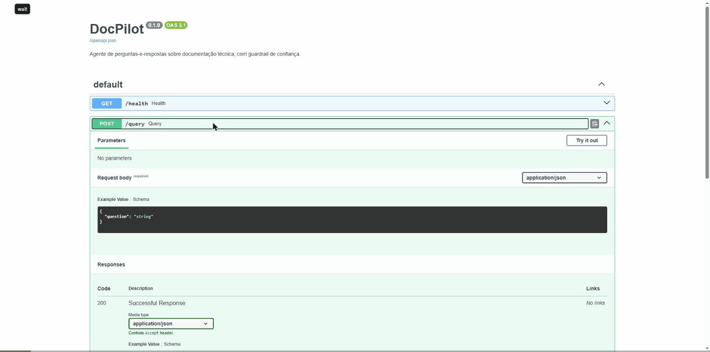

# Azure deployment evidence (Block 21)

All on 2026-10-18 (times in UTC), from the working tree on top of commit
`512f6e7`, with Terraform 1.15.8, azurerm 5.10.0, azapi 2.13.0 and Azure CLI
2.91.0. Subscription: Azure for Students (88 EUR of credit, nothing spent
before this run). Region: Sweden Central. The architecture is described in
`docs/azure-architecture.md`.

## Timeline

| Time (UTC) | Step |
|---|---|
| 20:51:24 | First `terraform apply` (18 resources planned) |
| 20:55:58 | 16 created; 2 failed (see "Problems found during the deploy") |
| 20:52-20:54 | Image `docpilot-api:v21` pushed to ACR from the laptop: 103 s, about 1.2 GB compressed |
| 20:57:05 | Second apply after the fixes: Azure OpenAI deployment and Container Apps Environment created |
| about 21:04-21:07 | Environment recreated in `WorkloadProfiles` mode (azapi) |
| 21:07:30 | Container App created (apply took 25 s); public URL live |
| 21:08:32 | Replica indexed the corpus: 5 documents, 167 chunks, 11.6 s (Log Analytics) |
| 21:08:40 | `uvicorn` running; `/health` answered 200 49 s after the app was created |
| 21:08:57-21:13:45 | Public smoke test, Swagger GIF and screenshots, evidence queries |
| 21:16:19 | Container App destroyed; the public URL answers 404 |
| 21:17:35 | Azure OpenAI smoke test (from the laptop, no public endpoint involved) |
| 21:19:30 | `terraform destroy` of everything else (18 resources) |
| 21:46:42 | Destroy complete; deleting the Container Apps Environment alone took 26 min 21 s |
| 21:47:07 | Verified: resource group gone, 0 resources in the subscription, 0 soft-deleted Key Vaults or Cognitive Services accounts |

The public URL was live for about 9 minutes (21:07:30 to 21:16:19). Billed
resources existed for about 55 minutes in total (20:51 to 21:46), most of the
tail being the environment deletion, with no replica running.

## Public API smoke test

`python -X utf8 scripts/azure_smoke_test.py <api_url>`, 21:08:57, against the
deployed Container App (Groq as the generator, as locally). N = 4 dev
questions: two answerable (PT, EN) and two outside the corpus.

| Case | Language | Expected | Result | Confidence | Latency |
|---|---|---|---|---|---|
| 13 | pt | answer | answered, source `trendpulse-ai-readme.md` | 0.978 | 7.30 s |
| 33 | en | answer | answered, source `financial-crew-readme.md` | 0.926 | 1.68 s |
| 41 | pt | refuse | refused | 0.001 | 0.40 s |
| 42 | en | refuse | refused | 0.001 | 0.41 s |

4/4 behaved as expected. The first request includes loading the models in
the new replica. Case 42 was refused in Portuguese; the refusal message is
fixed in Portuguese, the language limitation already reported in
`docs/evaluation-results.md`.

The GIF and screenshots below were taken from the Swagger UI of the public
URL (one answer, one refusal); the request URL is visible in each.

- `docs/azure/swagger-answer.png`: question about TrendPulse AI messaging,
  answered with RabbitMQ and cited source, confidence 0.986.
- `docs/azure/swagger-refusal.png`: out-of-scope question, refused,
  confidence 0.001.
- `docs/azure/resource-group.png`: the resource group in the Azure portal
  (cropped to exclude the account and subscription ID).

## Configuration checks on the live app

From the Container Apps REST API (2026-07-01), 21:14:18:

- Two containers in one replica: `api` (1.5 vCPU, 3 GiB, image
  `acr...azurecr.io/docpilot-api:v21`) and `qdrant` (0.5 vCPU, 1 GiB,
  `qdrant/qdrant:v1.19.0`); `minReplicas = maxReplicas = 1`.
- Registry authentication through the user-assigned identity (no username,
  no password secret).
- Both secrets (`groq-api-key`, `mongo-uri`) are Key Vault references
  (`keyVaultUrl`), with no value in the app definition.

## Logs and query log

- Log Analytics (`ContainerAppConsoleLogs_CL`, queried through the REST
  API): the indexing line, the `uvicorn` start line and six
  `POST /query ... 200 OK` lines, one per request.
- Cosmos DB for MongoDB: six documents in `docpilot.query_traces`, one per
  `/query` call, with question, confidence and decision. The API only
  inserts, which works unchanged with `pymongo`; see the sort finding below.

## Retrieval parity of the start-up index

Before deploying, the image was run locally the way Container Apps runs it:
a fresh Qdrant v1.19.0 container with no volume and `INDEX_ON_STARTUP=true`.
The replica indexed 167 chunks in 15.6 s and was ready in 36 s. For all 53
main-corpus dev questions, the reranked lists (source and position) from that
index were identical to the local index; the largest score difference was
0.0001. N = 53, retrieval only, 0 LLM calls.

## Azure OpenAI provider smoke test

`python -X utf8 scripts/azure_openai_smoke_test.py`, 21:17:35, with
`LLM_PROVIDER` code path `azure_openai`, deployment `gpt-4.1-mini`
(2025-04-14, GlobalStandard), running the DocPilot graph on the laptop
against the local Qdrant.

| Case | Result | Azure calls |
|---|---|---|
| 13 (pt) | answered, `RandomForestRegressor`, source cited | 1 |
| 33 (en) | answered, three agents, source cited | 1 (waited 59.65 s for the rate limiter) |
| 42 (en) | refused before generation | 0 |
| 13 again | served from the LLM cache | 0 |

Two real calls in total. Constraints of this subscription, applied only in
this test: the gateway enforced 1,000 tokens and 1 request per minute even
after the deployment was raised to capacity 10 (10,000 TPM, confirmed by
the deployment API; the response headers still reported
`x-ratelimit-limit-tokens: 1000` after six minutes). A five-chunk RAG prompt
is about 1,000 tokens (measured with `tiktoken` o200k_base: 962-1,044 for
four questions), so the test used `RETRIEVAL_TOP_K=3`,
`AZURE_OPENAI_MAX_TOKENS=150` and `AZURE_OPENAI_MAX_CALLS_PER_MINUTE=1`. These
settings are not the project defaults and the deployed API did not use Azure
OpenAI.

## Azure Function (local only)

`func start` (Core Tools 4.15.2, Python 3.12.6 worker) against Azurite
3.37.0 in Docker, collection `docpilot_v2_azure_demo`, using
`python -X utf8 scripts/azure_function_demo.py <file>`:

| Upload | Points before | Points after | Upload to indexed | Function duration |
|---|---|---|---|---|
| `financial-crew-readme.md` | 0 | 44 | 12.2 s | 9.2 s (models loading) |
| `trendpulse-ai-readme.md` | 44 | 94 | 6.0 s | 3.6 s |

The host log shows `New blob detected(LogsAndContainerScan)` for each upload.
Azurite had to run with `--skipApiVersionCheck`: the Python storage SDK
(12.31.0) and the Functions host send API versions newer than the latest
Azurite release supports. Not deployed to Azure (reasons in
`docs/azure-architecture.md`).

## Problems found during the deploy

- `gpt-4o-mini` 2024-07-18 still showed quota but the deployment failed with
  `ServiceModelDeprecated` (deprecated since 2026-03-31). Switched to
  `gpt-4.1-mini` 2025-04-14, which had quota only as GlobalStandard.
- azurerm 5.x requires `logs_destination = "log-analytics"` when a Log
  Analytics workspace is set on the environment.
- Without an explicit mode, the environment was created as an Express
  environment (`environmentMode: "Express"` in API 2026-07-01), which rejects
  Key Vault references (`ExpressEnvironmentFeatureNotSupported`) and does not
  support sidecar containers. azurerm 5.10 does not expose the mode, so the
  environment is created with `azapi` and `environmentMode =
  "WorkloadProfiles"`.
- Azure OpenAI capacity 1 (1,000 TPM) rejected a single RAG prompt with 429.
- Cosmos DB for MongoDB indexes only `_id` by default: a server-side
  `sort("created_at")` fails with "The index path corresponding to the
  specified order-by item is excluded". The API path is unaffected (insert
  only), but `get_recent_queries` and `get_low_confidence_queries` in
  `src/agent/query_log.py` would need an index on `created_at` to run against
  Cosmos DB.

## Teardown

`terraform destroy` removed all 18 remaining resources in 27 minutes; Key
Vault and Azure OpenAI were purged on destroy, so the names can be reused.
Checked at 21:47:07: `az group exists --name rg-docpilot` returned `false`,
`az resource list` returned no resources, and there were no soft-deleted Key
Vaults or Cognitive Services accounts.

Cost actually charged: pending. Azure Cost Management reports usage with a
delay of up to 24-48 hours; the figure will be added here from the portal
rather than estimated.
